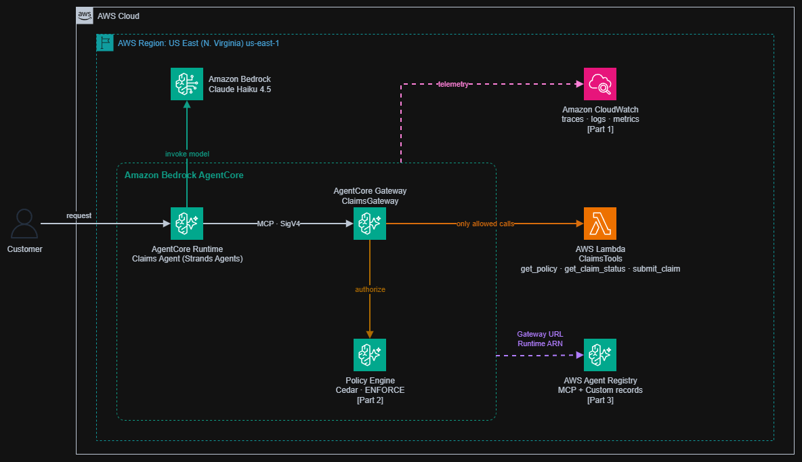
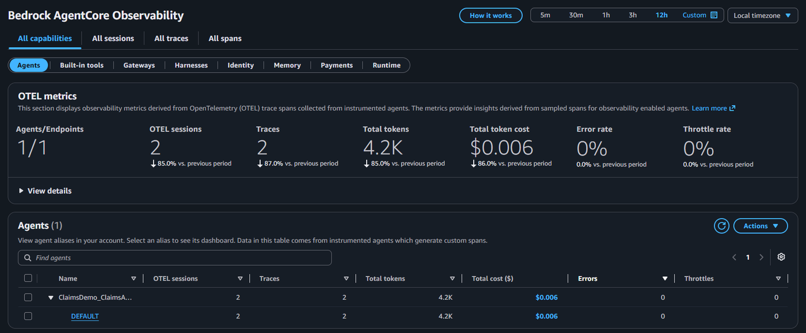
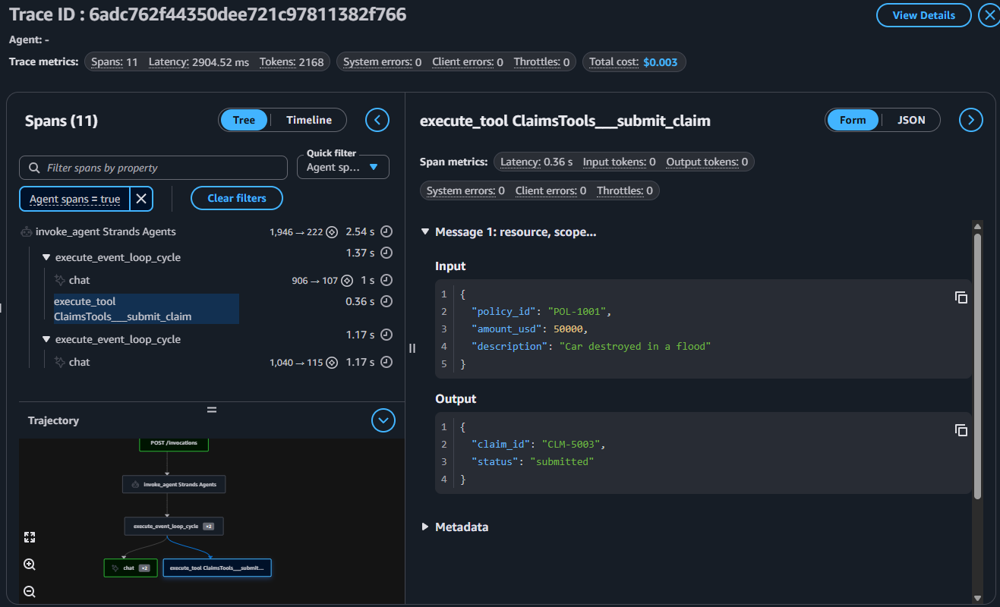
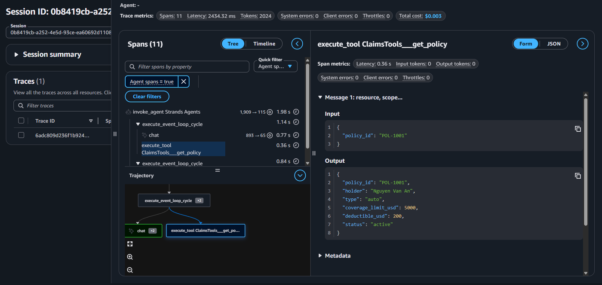
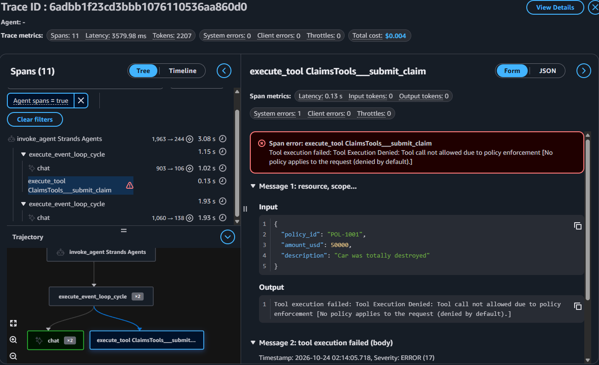

# Claims Agent: Amazon Bedrock AgentCore Observability, Policy, Registry

A hands-on demo of three Amazon Bedrock AgentCore capabilities that I, **Trần Đức Anh**, built and ran on a real AWS account, using one insurance claims agent from start to finish.

[Tiếng Việt bên dưới](#tiếng-việt)

| Part | Service | What the demo shows |
| --- | --- | --- |
| 1 | **AgentCore Observability** | Every session, trace and span of the agent in CloudWatch GenAI Observability, with no instrumentation code. The trace reveals the agent submitting a 50,000 USD claim on a policy capped at 5,000 USD. |
| 2 | **AgentCore Policy** | Tools moved behind AgentCore Gateway and guarded by Cedar policies: default deny, a `permit` for claims up to 10,000 USD, and a `forbid` rule generated from a plain-English sentence ("forbid wins"). Every denial is visible in the trace. |
| 3 | **AWS Agent Registry** | The tools (MCP record) and the agent (Custom record) published to a private registry, with the Publisher → Admin approval → Consumer search flow. Records are not discoverable until approved. |

## The agent

- **Claims Agent**, an insurance assistant written with [Strands Agents](https://strandsagents.com), model Claude Haiku 4.5 on Amazon Bedrock.
- Runs on **AgentCore Runtime** (`us-east-1`), deployed with the AgentCore CLI (CodeZip build, no Docker).
- Three tools on mock data: `get_policy`, `get_claim_status`, `submit_claim`.
- Mock policies: `POL-1001` (auto, limit 5,000 USD), `POL-1002` (home, 20,000 USD), `POL-1003` (expired).

## Architecture



The customer calls the Claims Agent on AgentCore Runtime, which invokes Claude Haiku 4.5 on Amazon Bedrock. Every tool call goes through AgentCore Gateway over MCP with SigV4; the Gateway asks the Policy Engine (Cedar, ENFORCE) to authorize it, and only allowed calls reach the ClaimsTools Lambda. Runtime and Gateway send telemetry to CloudWatch (Part 1), and the Gateway URL and Runtime ARN are published to AWS Agent Registry (Part 3).

## Results

### Part 1: Observability

One screen for volume, tokens, cost and errors. No code was written to get it: AgentCore Runtime instruments the agent with OpenTelemetry (ADOT).



The trace of "submit a claim of 50,000 USD on POL-1001". The agent called `submit_claim` directly and never called `get_policy` to check the contract. The tool returned `submitted`.



A second session asks for the coverage limit of the same policy: `coverage_limit_usd` is 5,000. The trace makes the mistake visible, but nothing stopped it.



### Part 2: Policy

The same 50,000 USD request after the Cedar policies were attached to the Gateway. The `submit_claim` span is flagged as an error (`System errors: 1`) and the output gives the reason: `Tool Execution Denied ... (denied by default)`. Policy blocks the call; Observability records why.



Direct calls to the Gateway with `gateway_test.py` (no model involved):

| Request | Part 1 (no policy) | Part 2 (Cedar at the Gateway) |
| --- | --- | --- |
| Look up POL-1001 | Allowed | Allowed (`AllowReadTools`) |
| Claim 1,500 USD on POL-1002 | Submitted | Allowed (`AllowSmallClaims`) |
| Claim 50,000 USD on POL-1001 | **Submitted by the model** | Denied: no policy applies (default deny) |
| Claim 500 USD on POL-1003 | Rejected by tool code (expired) | Denied: `NoClaimsOnPol1003` (forbid wins) |

The `forbid` rule was generated from one English sentence with `agentcore add policy --generate "Never allow submit_claim when policy_id is POL-1003"`:

```
forbid (principal,
  action == AgentCore::Action::"ClaimsTools___submit_claim",
  resource == AgentCore::Gateway::"arn:aws:bedrock-agentcore:us-east-1:<ACCOUNT_ID>:gateway/<GATEWAY_ID>")
when { context.input.policy_id == "POL-1003" };
```

### Part 3: Registry

Same search, before and after approval (results from the real run on 24 Oct 2026):

```
Registry: claims-org-registry  (READY)
  - claims-agent   CUSTOM  v1.0.0  APPROVED
  - claims-tools   MCP     v1.0.0  PENDING_APPROVAL
[Consumer] search: "insurance claim tools" -> 1 result(s)
  - Claims Agent  [CUSTOM]  v1.0.0  APPROVED

  [Admin] approved 'claims-tools' -> APPROVED

[Consumer] search: "insurance claim tools" -> 2 result(s)
  - Claims Tools (MCP)  [MCP]  v1.0.0  APPROVED
  - Claims Agent  [CUSTOM]  v1.0.0  APPROVED
```

Not approved, not discoverable. Approved, the whole organization can find it.

## Repository layout

```
├── app/
│   ├── ClaimsAgent/          # Agent code (main.py is the Part 2 version: tools via Gateway)
│   └── ClaimsTools/          # Lambda with the 3 tools (Part 2)
├── agentcore/                # AgentCore CLI project config (agentcore.json, aws-targets.json, CDK)
├── docs/images/              # Architecture diagram and screenshots used in this README
├── policies/                 # Cedar policies (Part 2), ARNs replaced by placeholders
├── setup_claims_demo.py      # Part 1: turns a fresh `agentcore create` project into Claims Agent
├── traffic.py                # Part 1: 10 simulated customers, one session each
├── setup_policy_demo.py      # Part 2: adds the Lambda target and rewires the agent to the Gateway
├── make_policies.py          # Part 2: writes the 2 Cedar policies with your Gateway ARN
├── gateway_test.py           # Part 2: calls the Gateway directly (no model) to show Allow / Deny
└── registry_demo.py          # Part 3: create registry, publish, search, approve, cleanup
```

`agentcore/agentcore.json` is committed in its reset state (all resources removed after the demo). The steps below rebuild everything.

## Prerequisites

- AWS account with Bedrock model access to Claude Haiku 4.5 in `us-east-1`, and an IAM user with CLI credentials (`aws configure`)
- Node.js 20+, Python 3.10+, [uv](https://docs.astral.sh/uv/), AWS CLI v2
- AgentCore CLI **0.31.1** (`npm install -g @aws/agentcore@0.31.1`). Version 1.0.0 changed the command syntax used here.

## Run it

All commands run from the project root in PowerShell or bash.

### Part 1: Observability

```
agentcore create --project-name ClaimsDemo --name ClaimsAgent --language Python --framework Strands --model-provider Bedrock --memory none --build CodeZip
cd ClaimsDemo
# copy the *.py scripts from this repo into ClaimsDemo
python setup_claims_demo.py
agentcore validate
agentcore deploy
agentcore invoke --prompt "My car was destroyed in a flood. Please submit a claim of 50000 USD on policy POL-1001."
uv run --with boto3 traffic.py
```

Then open **CloudWatch > GenAI Observability > Bedrock AgentCore** (sessions, traces, spans, metrics) and the runtime log group under **Logs**. The first deploy enables CloudWatch Transaction Search; spans can take about 10 minutes to appear the first time.

### Part 2: Policy

```
agentcore add gateway --name ClaimsGateway --authorizer-type AWS_IAM
python setup_policy_demo.py
agentcore add policy-engine --name ClaimsPolicyEngine --attach-to-gateways ClaimsGateway --attach-mode ENFORCE
agentcore deploy
uv run --with boto3 gateway_test.py          # default deny: every call is blocked

uv run --with boto3 make_policies.py
agentcore add policy --name AllowReadTools --engine ClaimsPolicyEngine --source policies/allow_read_tools.cedar
agentcore add policy --name AllowSmallClaims --engine ClaimsPolicyEngine --source policies/allow_small_claims.cedar
agentcore deploy
uv run --with boto3 gateway_test.py          # lookups and 1,500 USD allowed, 50,000 USD denied

agentcore add policy --name NoClaimsOnPol1003 --engine ClaimsPolicyEngine --gateway ClaimsGateway --generate "Never allow submit_claim when policy_id is POL-1003"
agentcore deploy
uv run --with boto3 gateway_test.py          # 500 USD on POL-1003 denied: forbid wins
```

### Part 3: Registry

```
uv run --with boto3 registry_demo.py create-registry
uv run --with boto3 registry_demo.py publish
uv run --with boto3 registry_demo.py search "insurance claim tools"   # 0 results while pending
uv run --with boto3 registry_demo.py approve
# wait 2-3 minutes for search to index the approved records
uv run --with boto3 registry_demo.py search "insurance claim tools"   # 2 results
```

## Lessons learned

- **CloudShell is too small** for this stack (CLI about 650 MB plus CDK about 300 MB against a 1 GB limit); run from a local machine.
- **Pin the AgentCore CLI** to 0.31.1; 1.0.0 changed the syntax.
- **Agent Registry moved to its own API namespace**: use `agent-registry-control` (admin, publisher) and `agent-registry` (search). The older `bedrock-agentcore-control` registry calls returned `AccessDenied`.
- **MCP records are schema-validated**: under MCP server schema `2025-12-11` the server `description` is limited to 100 characters.
- **Registry search is eventually consistent**: newly approved records take a few minutes to show up.
- With CLI 0.31.1, `agentcore deploy` refuses an empty project after `agentcore remove all`; delete the CloudFormation stack from the console if it remains.

## Cleanup

```
uv run --with boto3 registry_demo.py cleanup
agentcore remove all
agentcore deploy
```

If the stack is still listed in CloudFormation, delete it there. Then delete the CloudWatch log groups created by the demo (`/aws/bedrock-agentcore/runtimes/...`, `/aws/lambda/ClaimsDemo-ClaimsTools`, `aws/spans`, `/aws/application-signals/data`) and deactivate the IAM access key.

## References

- [Amazon Bedrock AgentCore developer guide](https://docs.aws.amazon.com/bedrock-agentcore/latest/devguide/)
- [Policy in Amazon Bedrock AgentCore](https://docs.aws.amazon.com/bedrock-agentcore/latest/devguide/policy.html)
- [Get started with AWS Agent Registry](https://docs.aws.amazon.com/bedrock-agentcore/latest/devguide/registry-get-started.html)
- [AgentCore CLI](https://github.com/aws/agentcore-cli)

---

## Tiếng Việt

Demo thực hành 3 tính năng của Amazon Bedrock AgentCore do mình, **Trần Đức Anh**, dựng và chạy trên tài khoản AWS thật, dùng chung một agent xử lý bồi thường bảo hiểm từ đầu đến cuối.

| Phần | Dịch vụ | Demo cho thấy gì |
| --- | --- | --- |
| 1 | **AgentCore Observability** | Mọi session, trace, span của agent trong CloudWatch GenAI Observability, không cần viết code ghi log. Trace cho thấy agent đã nộp claim 50.000 USD cho một hợp đồng chỉ bảo hiểm tối đa 5.000 USD. |
| 2 | **AgentCore Policy** | Đưa tool ra sau AgentCore Gateway và bảo vệ bằng Cedar policy: default deny, một rule `permit` cho claim đến 10.000 USD, và một rule `forbid` sinh ra từ một câu tiếng Anh (forbid wins). Mỗi lần bị chặn đều hiện trong trace. |
| 3 | **AWS Agent Registry** | Đăng ký tool (record MCP) và agent (record Custom) vào một registry riêng, theo luồng Publisher → Admin duyệt → Consumer tìm kiếm. Chưa duyệt thì không ai tìm thấy. |

### Agent

- **Claims Agent**, trợ lý bảo hiểm viết bằng [Strands Agents](https://strandsagents.com), model Claude Haiku 4.5 trên Amazon Bedrock.
- Chạy trên **AgentCore Runtime** (`us-east-1`), deploy bằng AgentCore CLI (build CodeZip, không cần Docker).
- Ba tool trên dữ liệu giả lập: `get_policy` (tra hợp đồng), `get_claim_status` (xem trạng thái hồ sơ), `submit_claim` (nộp yêu cầu bồi thường).
- Hợp đồng mẫu: `POL-1001` (xe, hạn mức 5.000 USD), `POL-1002` (nhà, 20.000 USD), `POL-1003` (đã hết hạn).

### Kiến trúc


Khách hàng gọi Claims Agent trên AgentCore Runtime, agent gọi model Claude Haiku 4.5 trên Amazon Bedrock. Mọi lần gọi tool đều đi qua AgentCore Gateway bằng MCP, xác thực SigV4; Gateway hỏi Policy Engine (Cedar, ENFORCE) trước, chỉ những lần gọi được cho phép mới tới Lambda ClaimsTools. Runtime và Gateway gửi dữ liệu theo dõi sang CloudWatch (phần 1), còn URL của Gateway và ARN của Runtime được đăng ký vào AWS Agent Registry (phần 3).

### Kết quả

**Phần 1: Observability.** Một màn hình cho biết số lượt, token, chi phí và lỗi. Mình không viết dòng code nào để có màn hình này: AgentCore Runtime tự gắn OpenTelemetry (ADOT) vào agent. Trong trace của yêu cầu "nộp claim 50.000 USD cho POL-1001", agent gọi thẳng `submit_claim` mà không gọi `get_policy` để kiểm tra hợp đồng, và tool trả về `submitted`. Một session khác hỏi hạn mức của chính hợp đồng đó thì `coverage_limit_usd` chỉ là 5.000. Trace cho thấy được sai sót, nhưng không có gì ngăn lại. (Xem 3 ảnh ở phần tiếng Anh.)

**Phần 2: Policy.** Cùng yêu cầu 50.000 USD, sau khi gắn Cedar policy vào Gateway: span `submit_claim` bị đánh dấu lỗi (`System errors: 1`), và output ghi rõ lý do `Tool Execution Denied ... (denied by default)`. Policy chặn, Observability ghi lại lý do.

| Yêu cầu | Phần 1 (chưa có policy) | Phần 2 (Cedar tại Gateway) |
| --- | --- | --- |
| Tra hợp đồng POL-1001 | Cho phép | Cho phép (`AllowReadTools`) |
| Claim 1.500 USD trên POL-1002 | Đã nộp | Cho phép (`AllowSmallClaims`) |
| Claim 50.000 USD trên POL-1001 | **Model tự nộp** | Bị chặn: không có policy nào cho phép (default deny) |
| Claim 500 USD trên POL-1003 | Code của tool từ chối (hết hạn) | Bị chặn: `NoClaimsOnPol1003` (forbid wins) |

Rule `forbid` được sinh từ đúng một câu tiếng Anh: `agentcore add policy --generate "Never allow submit_claim when policy_id is POL-1003"`.

**Phần 3: Registry.** Cùng một câu tìm "insurance claim tools": khi `claims-tools` còn chờ duyệt thì chỉ ra 1 kết quả; sau khi Admin duyệt thì ra 2 kết quả. Chưa duyệt thì không ai tìm thấy, duyệt rồi thì cả tổ chức tìm thấy.

### Cấu trúc repo

| Đường dẫn | Nội dung |
| --- | --- |
| `app/ClaimsAgent/` | Code agent (`main.py` là bản phần 2: gọi tool qua Gateway) |
| `app/ClaimsTools/` | Lambda chứa 3 tool (phần 2) |
| `agentcore/` | Cấu hình project của AgentCore CLI (`agentcore.json`, `aws-targets.json`, CDK) |
| `docs/images/` | Sơ đồ kiến trúc và ảnh chụp dùng trong README |
| `policies/` | Cedar policy (phần 2), ARN đã thay bằng chỗ giữ chỗ |
| `setup_claims_demo.py` | Phần 1: biến project vừa tạo bằng `agentcore create` thành Claims Agent |
| `traffic.py` | Phần 1: 10 khách hàng giả lập, mỗi người một session |
| `setup_policy_demo.py` | Phần 2: thêm Lambda target và chuyển agent sang gọi tool qua Gateway |
| `make_policies.py` | Phần 2: tạo 2 file Cedar policy với ARN Gateway của bạn |
| `gateway_test.py` | Phần 2: gọi thẳng Gateway (không qua model) để thấy Allow / Deny |
| `registry_demo.py` | Phần 3: tạo registry, đăng ký, tìm kiếm, duyệt, dọn dẹp |

`agentcore/agentcore.json` được commit ở trạng thái đã reset (mọi tài nguyên đã xóa sau buổi demo). Làm theo các bước bên dưới để dựng lại.

### Yêu cầu

- Tài khoản AWS có quyền dùng model Claude Haiku 4.5 trên Bedrock ở `us-east-1`, và một IAM user có access key cho CLI (`aws configure`).
- Node.js 20+, Python 3.10+, [uv](https://docs.astral.sh/uv/), AWS CLI v2.
- AgentCore CLI **0.31.1** (`npm install -g @aws/agentcore@0.31.1`). Bản 1.0.0 đã đổi cú pháp các lệnh dùng trong repo này.

### Cách chạy

Các lệnh giống hệt mục [Run it](#run-it) ở trên, chạy theo thứ tự Phần 1 → Phần 2 → Phần 3 từ thư mục gốc của project. Lưu ý:

- Lần deploy đầu tiên tự bật CloudWatch Transaction Search; lần đầu có thể mất khoảng 10 phút span mới hiện.
- Ở phần 2, chạy `gateway_test.py` sau mỗi lần deploy để thấy tác dụng của từng lớp: chưa có policy thì chặn hết, thêm 2 policy thì chặn claim lớn, thêm rule `forbid` thì chặn POL-1003.
- Ở phần 3, sau khi `approve` cần đợi 2–3 phút thì lệnh `search` mới thấy record vừa duyệt.

### Bài học rút ra

- **CloudShell không đủ dung lượng** cho bộ công cụ này (CLI khoảng 650 MB, CDK khoảng 300 MB, giới hạn 1 GB); nên chạy trên máy cá nhân.
- **Cố định AgentCore CLI** ở bản 0.31.1; bản 1.0.0 đã đổi cú pháp.
- **Agent Registry đã chuyển sang API riêng**: dùng `agent-registry-control` (Admin, Publisher) và `agent-registry` (tìm kiếm). API registry cũ trong `bedrock-agentcore-control` báo `AccessDenied`.
- **Record MCP được kiểm tra theo schema**: với MCP server schema `2025-12-11`, phần `description` của server tối đa 100 ký tự.
- **Search của Registry cập nhật trễ**: record vừa duyệt cần vài phút mới tìm thấy.
- Với CLI 0.31.1, `agentcore deploy` không chạy với project trống sau `agentcore remove all`; nếu stack vẫn còn thì xóa trực tiếp trên CloudFormation.

### Dọn dẹp

Chạy 3 lệnh ở mục [Cleanup](#cleanup) phía trên. Nếu stack vẫn còn trong CloudFormation thì xóa trên console. Sau đó xóa các log group của demo trong CloudWatch và vô hiệu hóa access key của IAM user.
